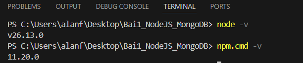
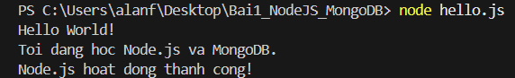

# BÀI 1: TỔNG QUAN NODE.JS VÀ MONGODB

## 1. Môi trường thực hành

- Hệ điều hành: Windows
- Node.js: v26.13.0
- npm: 11.20.0
- Công cụ lập trình: Visual Studio Code

## 2. Kiểm tra phiên bản

Sử dụng các lệnh sau để kiểm tra phiên bản:

- Lệnh `node -v`: v26.13.0
- Lệnh `npm -v`: 11.20.0

## 3. Chương trình hello.js

Nội dung file `hello.js`:

```javascript
console.log("Hello World!");
console.log("Toi dang hoc Node.js va MongoDB.");
```

## 4. Kết quả thực hiện

Chạy chương trình bằng lệnh:

```bash
node hello.js
```

Kết quả hiển thị:

```text
Hello World!
Toi dang hoc Node.js va MongoDB.
```

## 5. Hình ảnh minh chứng

### 5.1. Kiểm tra phiên bản Node.js và npm



### 5.2. Kết quả chạy chương trình hello.js



## 6. Kết luận

Em đã cài đặt và kiểm tra thành công Node.js và npm. Đồng thời, em đã tạo và chạy thành công chương trình JavaScript đầu tiên bằng Node.js. Qua bài thực hành, em đã hiểu được cách sử dụng Node.js để thực thi mã JavaScript bên ngoài trình duyệt.t.